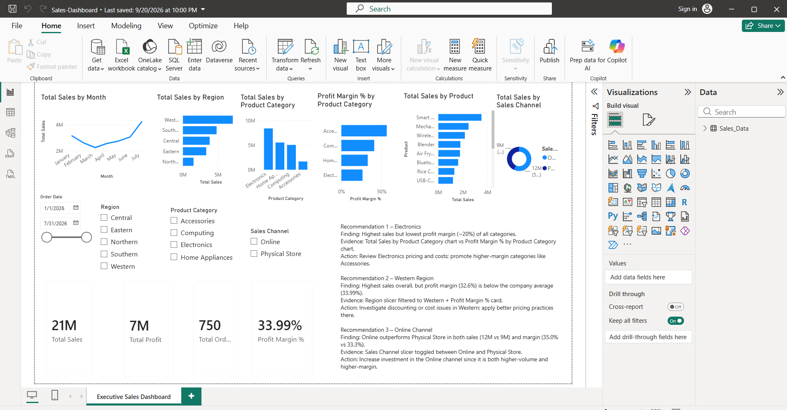

# NovaMart Retail Sales Dashboard (Power BI)

A one-page Executive Sales Dashboard built in Power BI Desktop from the NovaMart retail dataset (750 orders after cleaning, January to July 2026, Sri Lanka). Completed as a guided practical for CIT308 Data Visualization, BAIT, SLTC Research University.

## Dashboard preview

## Files

| File | Description |
|---|---|
| `Sales-Dashboard.pbix` | Power BI report (open with Power BI Desktop) |
| `NovaMart_PowerBI_CaseStudy_Dataset.xlsx` | Source dataset (`Sales_Data` and `Data_Dictionary` sheets) |
| `NovaMart_PowerBI_Simple_Tutorial.pdf` | Practical instructions this work follows |
| `Report.pdf` | Final report with a screenshot for each step |
| `dashboard.png` | Dashboard screenshot |

## What was done

1. **Import**: loaded the `Sales_Data` sheet from Excel and opened it in Power Query.
2. **Data checks**: found 5 duplicate Order IDs, 6 missing salespeople, inconsistent region labels (western, CENTRAL, South) and category labels (Electronic, Home Appliance).
3. **Cleaning**: removed duplicate Order IDs (755 to 750 rows), replaced missing salespeople with `Unknown`, standardised region and category labels, set correct data types.
4. **Calculated columns**: `Sales Amount = Quantity * Unit Price`, `Total Cost = Quantity * Unit Cost`, `Profit = Sales Amount - Total Cost`.
5. **DAX measures**: Total Sales, Total Cost, Total Profit, Total Orders, Total Quantity Sold, Profit Margin %.
6. **Dashboard**: 4 KPI cards and 6 charts (sales by month, region, category and channel, profit margin by category, top 5 products).
7. **Slicers**: Order Date, Region, Product Category, Sales Channel. All visuals update together.

## Headline numbers (full dataset)

| Measure | Value |
|---|---|
| Total Sales | 20,640,500 |
| Total Profit | 7,015,300 |
| Profit Margin | 33.99% |
| Total Orders | 750 |

## Key insights

- **Western** is the top region by sales (7.14M) but its margin (32.7%) is below the company average (34.0%).
- **Electronics** has the highest sales (8.40M) but the lowest margin of all categories (26.3%). **Accessories** sells far less but has the best margin (56.3%).
- **Online** brings 57% of sales (11.76M) with a higher margin than Physical Store (35.1% vs 32.5%).
- Top products by sales: Smart Watch, Mechanical Keyboard, Wireless Headphones.
- Looking at Total Sales alone hides profitability: the biggest revenue areas are not the most profitable ones.

## Tech

Power BI Desktop, Power Query, DAX

## Author

MM Fathima Sumla
